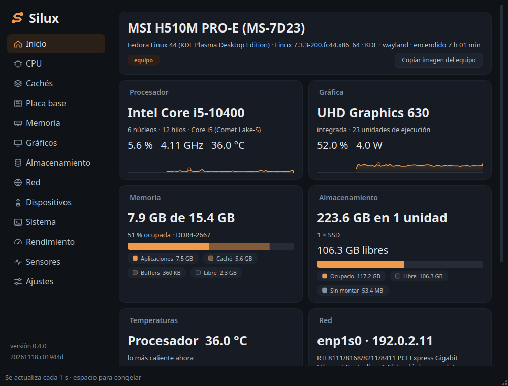
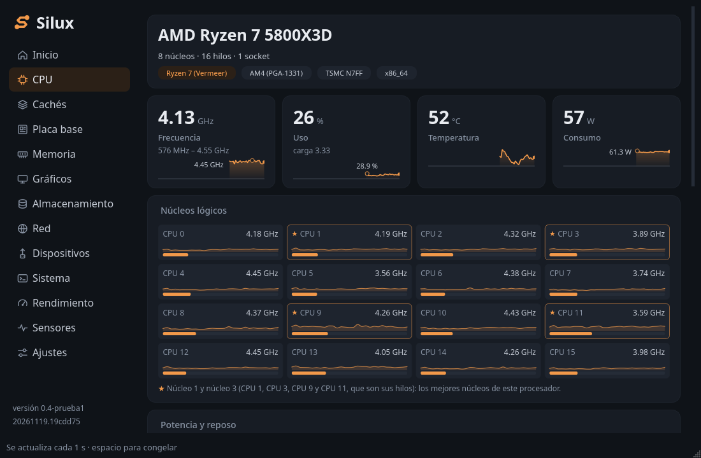
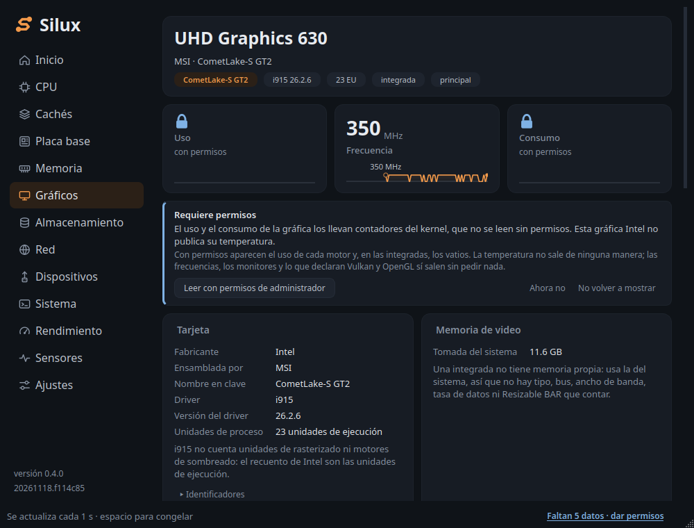
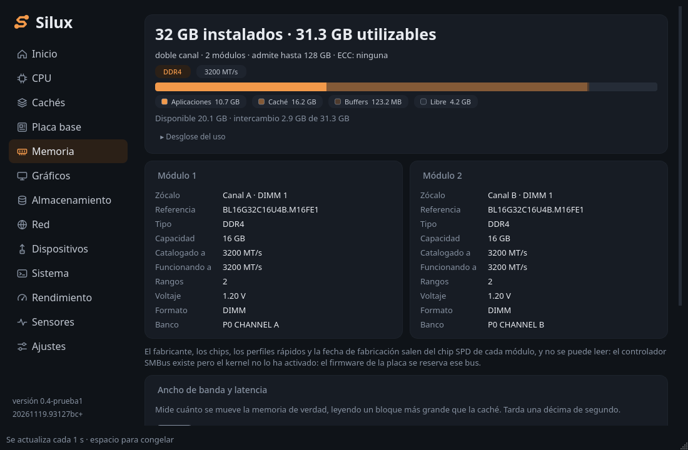
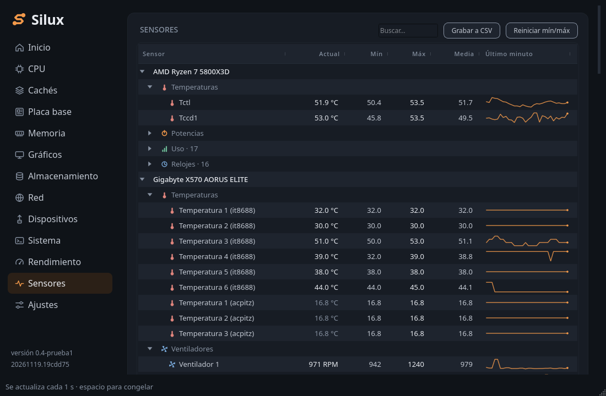

[Español](README.md) · **English**

#  Silux

[](https://github.com/rcv11x/silux/actions/workflows/appimage.yml)

Silux identifies the hardware in a Linux machine and keeps an eye on its sensors: what CPU-Z, GPU-Z and HWMonitor do on Windows, in a single program. When it can't read something, it tells you why. The interface is in Spanish and English.



<p>
  
  
  
  
</p>

## Download

Every [release](https://github.com/rcv11x/silux/releases) ships two AppImages. Both run on almost any distribution from 2022 onwards.

| File | Who it's for |
|---|---|
| `silux-x86_64.AppImage` | The regular one: for almost any PC (Intel since 2008, AMD since 2011). |
| `silux-x86_64-compat.AppImage` | Only if your PC is very old (Core 2, Athlon II, Phenom II…). If the regular one can't run on your processor, it tells you when you open it. |

<sub>For those who need the details: the regular one needs glibc 2.34 or later (RHEL 9, Ubuntu 22.04, Debian 12 and newer) and an x86-64-v2 processor; the compat one, glibc 2.35 or later and any 64-bit processor.</sub>

```
chmod +x silux-x86_64.AppImage
./silux-x86_64.AppImage
```

It works with [Linux 5.15](docs/kernel.md) or later. Some data, such as the memory modules, disk health or voltages, can only be read by the administrator: Silux asks for it when you click a padlock, explains first what it is going to read, and never changes anything on your machine.

From source, with [uv](https://docs.astral.sh/uv/), which brings Python 3.10 or later and PySide6:

```
git clone https://github.com/rcv11x/silux.git && cd silux
uv run --extra gui python -m silux.ui.app
```

## In the terminal

```
./silux-x86_64.AppImage --cli                 # all the hardware, on screen
./silux-x86_64.AppImage --sensors --watch     # the sensors, every second
./silux-x86_64.AppImage --json                # everything as JSON
./silux-x86_64.AppImage --cli --help          # every option
```

From source, the same with `uv run python -m silux.cli`.

## If something goes wrong

```
./silux-x86_64.AppImage --report report.md
```

Or from the window: Settings → «View and save the report…», which shows it to you before saving it.

It asks for your password so the report also includes what only the administrator can read. At the end it carries the raw data it read, which let Silux's tests reproduce your machine. It leaves out the machine's name, its addresses and every serial number: look it over and attach it to an [issue](https://github.com/rcv11x/silux/issues) (so that Silux recognises your machine better, with the [«Mi CPU y placa»](https://github.com/rcv11x/silux/issues/new?template=mi-cpu-y-placa.yml) template), or share it in the #silux-pruebas channel on the UniversoLinux Discord.

## More

The documentation is in Spanish.

- [Architecture](docs/arquitectura.md): how it is built and how to run each part.
- [Conventions](docs/convenciones.md): how to contribute.
- [Tested machines](docs/equipos-probados.md) and [what's still missing](docs/pendientes.md).
- [What changed in each release](CHANGELOG.md).

Silux is written with the help of Claude, Anthropic's AI assistant.

## License

GPL-3.0 or later: [LICENSE](LICENSE). The processor table includes data from libcpuid and CPU-X; their notices are in [THIRD_PARTY_NOTICES.md](silux/db/THIRD_PARTY_NOTICES.md).
