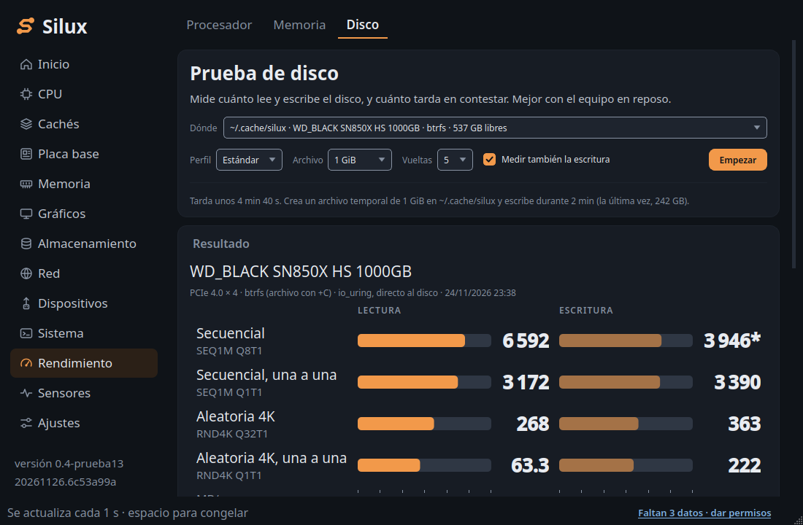
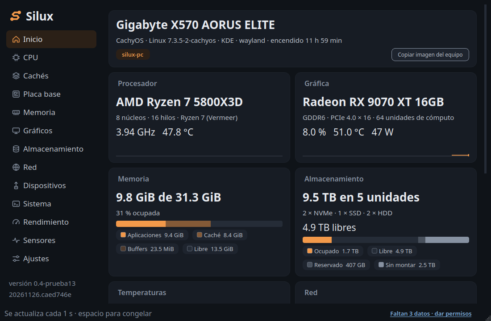
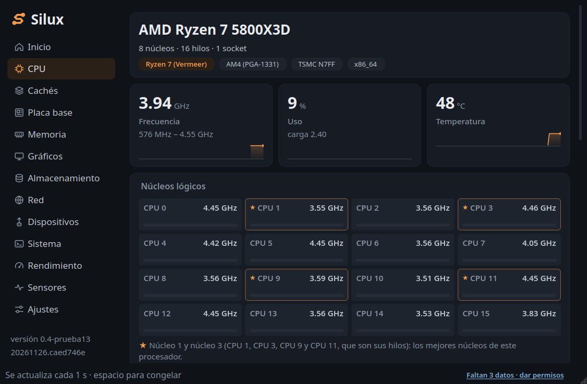
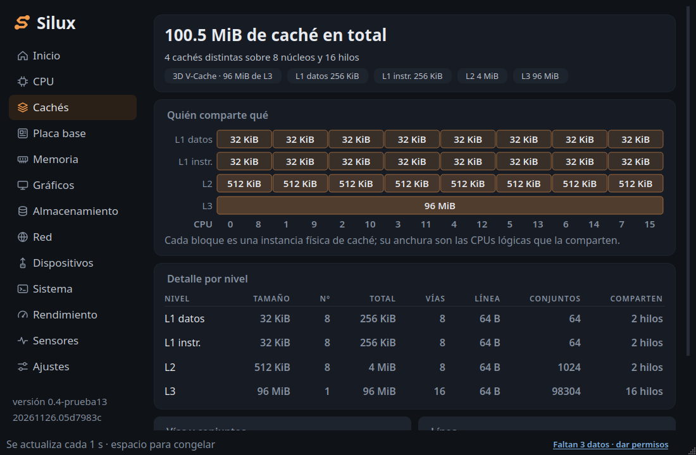
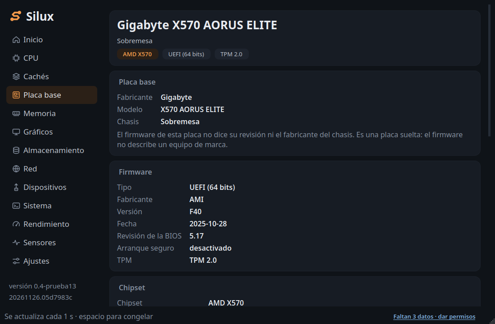
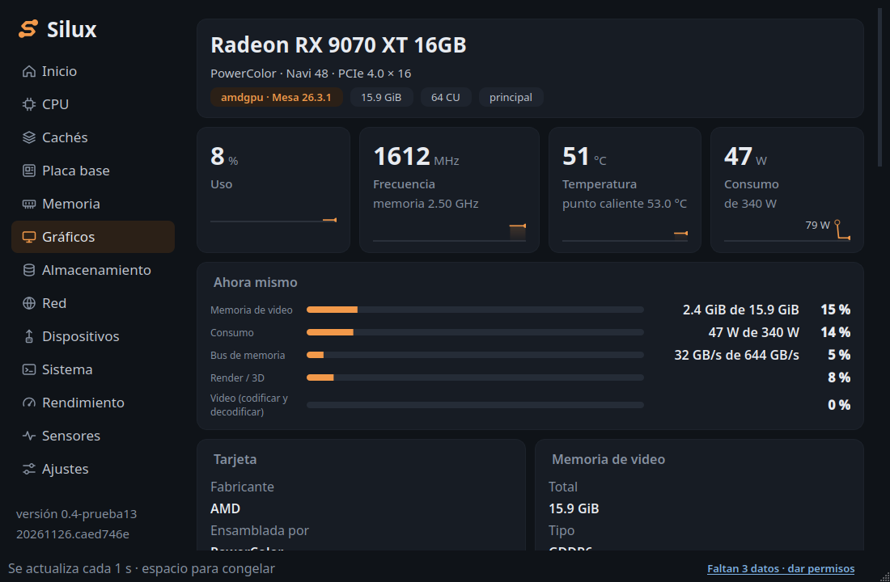
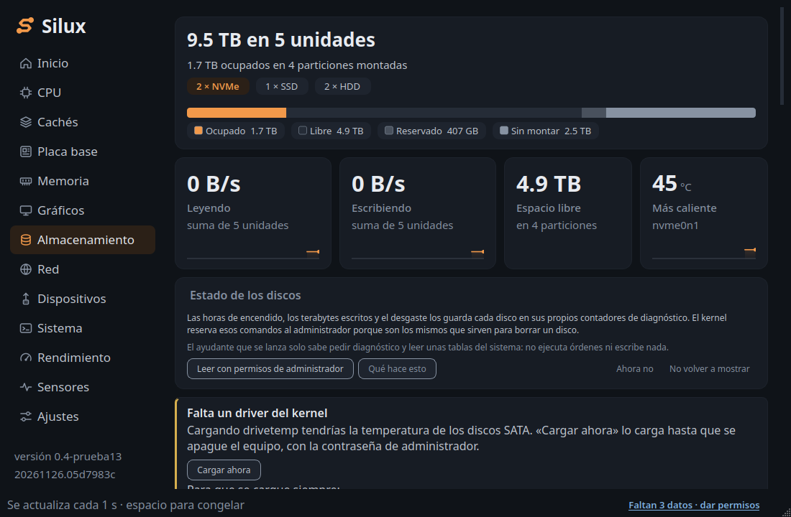
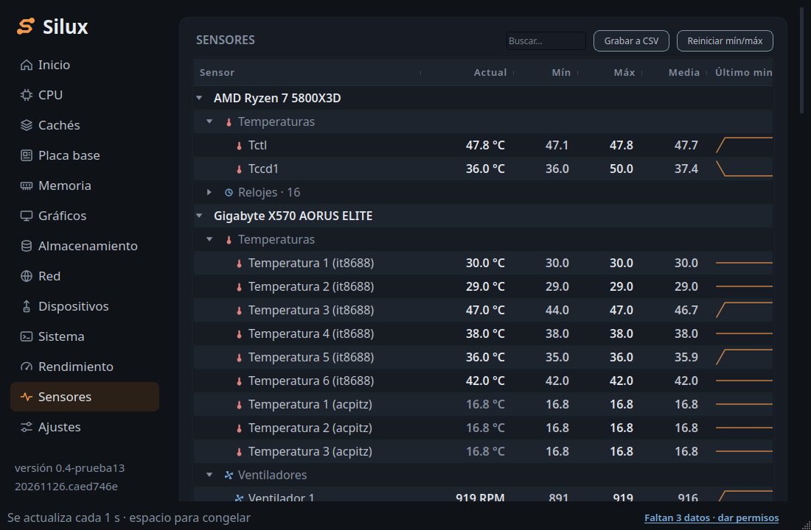
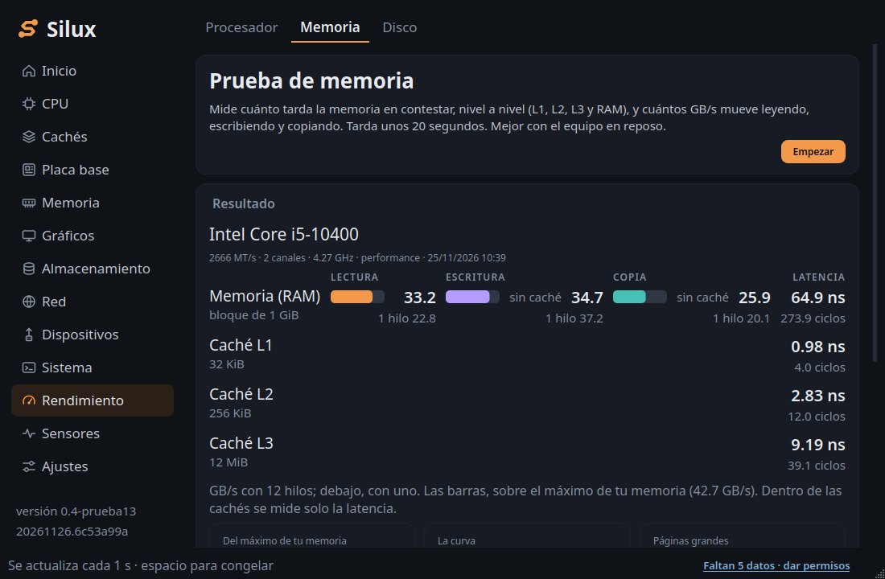

[English](README.md) · **Español**

#  Silux

[](https://github.com/rcv11x/silux/actions/workflows/appimage.yml)

Silux enseña qué hardware tiene un PC con Linux y qué está haciendo: procesador, memoria, gráficas, discos, red, batería y sensores.
Hace lo que en Windows hacen CPU-Z, GPU-Z y HWMonitor, en un solo programa, y cuando no puede leer un dato te dice por qué.



| Inicio | CPU |
|:---:|:---:|
|  |  |
| **Cachés** | **Placa base** |
|  |  |
| **Gráficos** | **Almacenamiento** |
|  |  |
| **Sensores** | **Prueba de memoria** |
|  |  |

## Descargar

Cada [versión](https://github.com/rcv11x/silux/releases) trae dos AppImage:

| Archivo | Cuál |
|---|---|
| `silux-x86_64.AppImage` | Este: funciona en casi cualquier PC. |
| `silux-x86_64-compat.AppImage` | Solo si el normal te dice que no puede funcionar en tu PC. |

```
chmod +x silux-x86_64.AppImage
./silux-x86_64.AppImage
```

Avisa cuando hay una versión nueva: al abrirse pregunta a GitHub por la última, sin mandar nada de tu equipo. Se puede apagar en Ajustes, y solo se actualiza cuando pulsas el botón.

<sub>El normal pide glibc 2.34 o posterior y el compat glibc 2.30 o posterior, los dos con [Linux 5.15](docs/kernel.md) o posterior. En qué procesadores funciona cada uno: [compatibilidad](docs/compatibilidad.md). La terminal, el informe y cómo ejecutarlo desde el código: [uso](docs/uso.md).</sub>

## Hoja de ruta

- [x] Identificar el hardware: procesador, cachés, placa base, memoria, gráficos, almacenamiento, red, dispositivos, batería y sistema
- [x] Sensores con su mínimo, máximo y media, y un registro en CSV
- [x] Prueba del procesador, con una puntuación que se compara entre equipos
- [x] Prueba de memoria: la latencia de cada nivel de caché y de la RAM, y el ancho de banda (experimental)
- [x] Prueba de disco, comparada con fio (experimental)
- [x] Español e inglés, y la terminal: el volcado, JSON, los sensores y el informe
- [x] Compartir el resultado de la prueba de disco y de la de memoria como imagen
- [ ] Elegir un disco en las gráficas de lectura y escritura de Almacenamiento
- [ ] Grabar una sesión: empezar, pausar y parar
- [ ] La última hora de cada sensor, y un modo bandeja
- [ ] Una prueba de la gráfica
- [ ] Los límites de potencia de AMD (PPT, TDC, EDC)
- [ ] Procesadores ARM, probados en uno de verdad (está escrito, nunca se ha ejecutado en uno)

## Gracias

A quienes mandan informes: con ellos Silux se prueba en equipos que no son los nuestros. Aquí sale quien ha dado permiso, y lo mismo en Ajustes → Acerca de.

<!-- thanks:start -->
- Anianin27
- Erziok
- Felix Lara
- jwpitr
- widecoocaa23_
<!-- thanks:end -->

## Más

- [Uso](docs/uso.md): la terminal, el informe para avisar de un fallo, cómo ejecutarlo desde el código y lo que necesita permisos de administrador.
- [Compatibilidad](docs/compatibilidad.md): qué AppImage, y el hardware en el que se ha probado Silux.
- [Lo que usa del sistema](docs/dependencias.md), [lo que falta](docs/pendientes.md) y [los cambios de cada versión](CHANGELOG.md).
- En inglés: [la arquitectura en corto](ARCHITECTURE.md), [cómo contribuir](CONTRIBUTING.md) y [cómo avisar de un problema de seguridad](SECURITY.md). El resto de `docs/` está en español, empezando por la [arquitectura](docs/arquitectura.md).

Silux se escribe con ayuda de Claude, el asistente de IA de Anthropic.

## Licencia

GPL-3.0 o posterior: [LICENSE](LICENSE). La tabla de procesadores lleva datos de libcpuid y CPU-X; sus avisos, en [THIRD_PARTY_NOTICES.md](silux/db/THIRD_PARTY_NOTICES.md).
