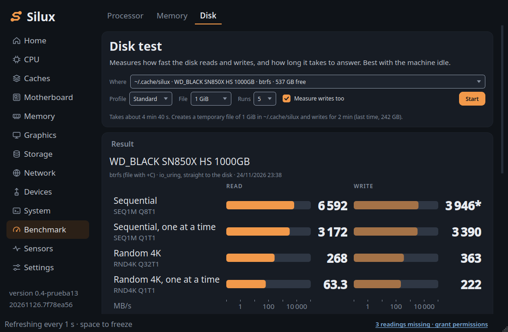

**English** · [Español](README.es.md)

#  Silux

[](https://github.com/rcv11x/silux/actions/workflows/appimage.yml)

Silux shows what hardware a Linux PC has and what it is doing: processor, memory, graphics, disks, network, battery and sensors.
It does what CPU-Z, GPU-Z and HWMonitor do on Windows, in one program, and when it can't read something it tells you why.



## Download

Every [release](https://github.com/rcv11x/silux/releases) ships two AppImages:

| File | Which one |
|---|---|
| `silux-x86_64.AppImage` | This one: works on almost any PC. |
| `silux-x86_64-compat.AppImage` | Only if the normal one tells you it won't run on your PC. |

```
chmod +x silux-x86_64.AppImage
./silux-x86_64.AppImage
```

<sub>The normal one needs glibc 2.34 or later and the compat one glibc 2.30 or later, both with [Linux 5.15](docs/kernel.md) or later. Which processors each one runs on: [compatibility](docs/compatibility.md). The terminal, reports and running from source: [usage](docs/usage.md).</sub>

## Roadmap

- [x] Identify the hardware: processor, caches, motherboard, memory, graphics, storage, network, devices, battery and system
- [x] Sensors with their minimum, maximum and average, and a log to CSV
- [x] Processor benchmark, with a score that compares between PCs
- [x] Memory benchmark: latency of each cache level and the RAM, and bandwidth (experimental)
- [x] Disk benchmark, checked against fio (experimental)
- [x] English and Spanish, and the terminal: a dump, JSON, the sensors and a report
- [ ] Share a disk result as an image
- [ ] Choose one disk in Storage's reading and writing charts
- [ ] Record a session: start, pause and stop
- [ ] The last hour of each sensor, and a tray mode
- [ ] A graphics benchmark
- [ ] AMD power limits (PPT, TDC, EDC)
- [ ] ARM processors, tested on real hardware (written, never run on one)

## Thanks

To everyone who sends reports: with them Silux is tested on machines that are not ours. Whoever has said so is named here, and in Settings → About.

<!-- thanks:start -->
- Anianin27
- Erziok
- Felix Lara
- jwpitr
- widecoocaa23_
<!-- thanks:end -->

## More

- [Usage](docs/usage.md): the terminal, the report for a bug, running from source and what needs the administrator.
- [Compatibility](docs/compatibility.md): which AppImage, and the hardware Silux has been tested on.
- [What it uses from the system](docs/dependencias.md), [what's still missing](docs/pendientes.md) and [what changed in each release](CHANGELOG.md).
- [A short architecture](ARCHITECTURE.md), [how to contribute](CONTRIBUTING.md) and [how to report a security problem](SECURITY.md). The rest of `docs/` is in Spanish, starting with the [architecture](docs/arquitectura.md).

Silux is written with the help of Claude, Anthropic's AI assistant.

## License

GPL-3.0 or later: [LICENSE](LICENSE). The processor table includes data from libcpuid and CPU-X; their notices are in [THIRD_PARTY_NOTICES.md](silux/db/THIRD_PARTY_NOTICES.md).
