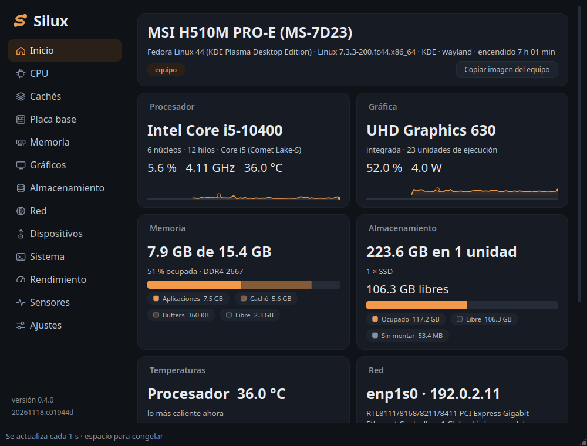
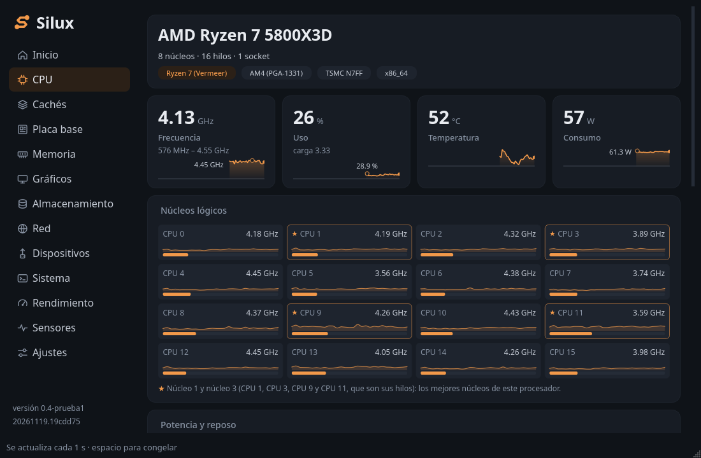
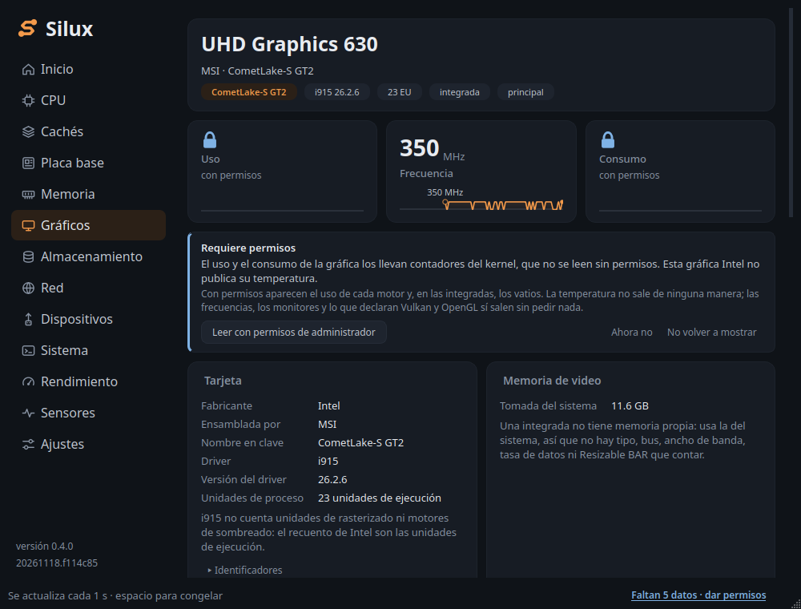
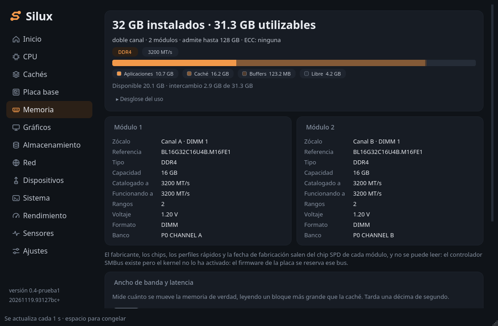
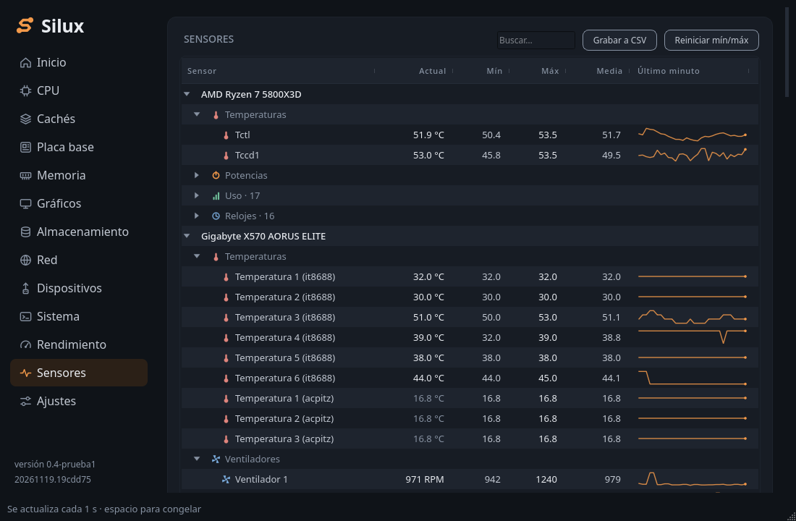

**English** · [Español](uso.md)

# Usage

How to open Silux, what it does in the terminal, how to send a report when
something goes wrong, and which data need the administrator. Which AppImage to
pick is in [compatibility](compatibility.md).



<p>
  
  
  
  
</p>

## Opening it

```
chmod +x silux-x86_64.AppImage
./silux-x86_64.AppImage
```

It works with [Linux 5.15](kernel.md) or later.

On KDE, the file shows Silux's logo when libappimage is installed (on Arch and
derivatives, `sudo pacman -S libappimage`).

## What needs the administrator

Some data, such as the memory modules, disk health or voltages, can only be
read by the administrator. Silux asks for it when you click a padlock and
explains first what it is going to read. Reading changes nothing. What does
change the system (loading a kernel module, leaving the permissions installed)
is said before it is done.

## From source

With [uv](https://docs.astral.sh/uv/), which brings Python 3.10 or later and
PySide6:

```
git clone https://github.com/rcv11x/silux.git && cd silux
uv run --extra gui python -m silux.ui.app
```

## In the terminal

```
./silux-x86_64.AppImage --cli                 # all the hardware, on screen
./silux-x86_64.AppImage --sensors --watch     # the sensors, every second
./silux-x86_64.AppImage --json                # everything as JSON
./silux-x86_64.AppImage --cli --help          # every option
```

From source, the same with `uv run python -m silux.cli`.

## If something goes wrong

```
./silux-x86_64.AppImage --report report.md
```

Or from the window: Settings → «View and save the report…», which shows it to
you before saving it.

It asks for your password so the report also includes what only the
administrator can read. At the end it carries the raw data it read, which let
Silux's tests reproduce your machine. It leaves out the machine's name, its
addresses and every serial number: look it over and attach it to an
[issue](https://github.com/rcv11x/silux/issues) (so that Silux recognises your
machine better, with the
[«Mi CPU y placa»](https://github.com/rcv11x/silux/issues/new?template=mi-cpu-y-placa.yml)
template), or share it in the #silux-pruebas channel on the UniversoLinux
Discord.
